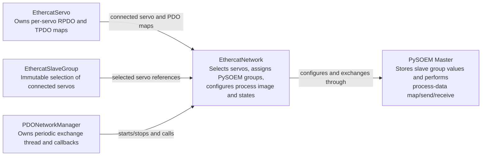
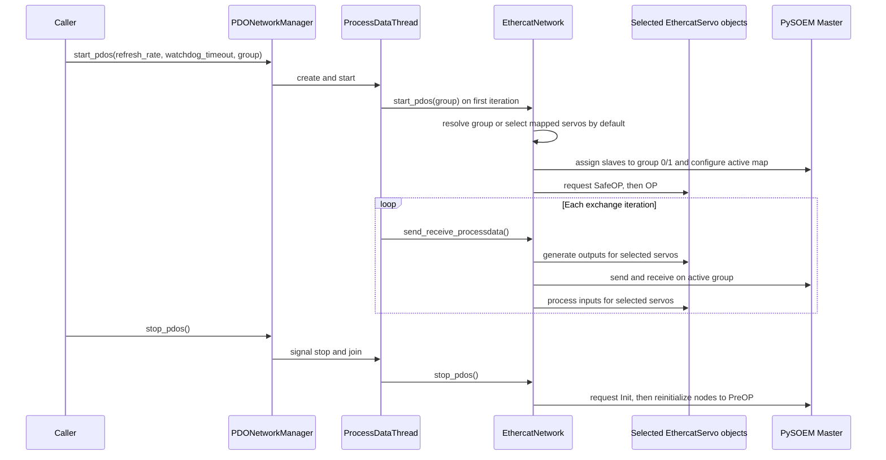

# EtherCAT PDO Groups and Lifecycle

This document describes EtherCAT PDO mapping and exchange behavior in
IngeniaLink. The terms *selected servos* and *PySOEM group* describe different
parts of the mapping configuration.

## Vocabulary

- **Discovered slave**: A physical EtherCAT slave present in the PySOEM master.
  The network addresses discovered slaves with 1-based `slave_id` values.
- **Connected servo**: An `EthercatServo` object registered on the network for a
  discovered slave. Discovered slaves can be present on the bus without a
  connected servo object.
- **PDO-mapped servo**: A connected servo with at least one configured RPDO or
  TPDO map.
- **EthercatSlaveGroup**: An immutable selection of connected `EthercatServo`
  objects. Group members have unique slave IDs and are validated against the
  network when used for mapping or startup.
- **PySOEM group**: The numeric `CdefSlave.group` value used by PySOEM when
  configuring and exchanging a process image. Only group `0` and group `1` are
  supported by this API.

`EthercatSlaveGroup` expresses which connected servos participate. Its
`slave_ids` property is derived from those servo references. The network keeps
the group as its active selection and resolves the PySOEM mapping group when it
configures the process image.

## Responsibilities



`EthercatServo` owns its per-drive PDO map configuration. `EthercatNetwork`
coordinates which connected servos participate, maps the selected process
image, and transitions selected servos to Operational. `EthercatSlaveGroup`
provides the selected servo references to network and manager APIs.
`PDONetworkManager` owns the cyclic background thread and passes its selected
group to the network for initial setup. The PySOEM master is where numeric
mapping groups are applied.

## Mapping Behavior

`EthercatNetwork.config_pdo_maps()` assigns every discovered slave to one of the
two PySOEM groups, then maps only the active group. Slaves not in the selected
set are assigned to the other group (`1 - active_group`). The call uses either
PySOEM's overlapping or regular map operation, depending on the network's
`overlapping_io_map` setting.

| Selection | Default active group | Meaning |
| --- | --- | --- |
| Omitted from `config_pdo_maps()` | `0` | Select every discovered slave. |
| A subset of discovered slave IDs | `1` | Put the selected subset in group 1 and all other discovered slaves in group 0. |
| Explicit `active_group=0` | `0` | Valid only when every discovered slave is selected. |
| Explicit `active_group=1` | `1` | Select the requested IDs in group 1; other discovered slaves are assigned to group 0. |

The default is based on discovered slaves, not connected servos. Explicit
`active_group` values must be `0` or `1`. Group 0 always maps the complete set
of discovered slaves, so selecting a subset with group 0 raises `ValueError`.
Group 1 can be used for a subset or for all discovered slaves.

`config_pdo_maps(group=...)` accepts an `EthercatSlaveGroup` and assigns its
members to the active PySOEM group. The lower-level `selected_slave_ids` form is
also available for configuring discovered slaves without connected servo
objects. `start_pdos()` validates that each group member is connected and has
configured PDO maps, then performs the state transitions.
`send_receive_processdata()` and the PDO manager drive process-data exchange.

## Starting PDOs

`EthercatNetwork.start_pdos()` performs initial mapping and state transitions.
`PDONetworkManager` owns and runs the periodic exchange thread.

When `group` is omitted, `start_pdos()` selects all connected servos that have
at least one RPDO or TPDO map. To select a subset, create an
`EthercatSlaveGroup` from the desired servo objects and pass it to startup.
Each member must belong to the network and have configured PDO maps; otherwise
startup raises `ValueError`.

The network resolves the PySOEM group automatically: group 0 when the selection
covers every discovered slave, otherwise group 1. Existing low-level callers
can continue to pass `selected_slave_ids` and `active_group` directly.

For the resolved selection, startup configures the map and transitions only the
selected PDO servos through SafeOP and OP. If a state transition times out, it
raises `ILStateError` and clears the network's active-exchange flag. If there
are no selected PDO servos, it logs a warning and returns without configuring
the process image.

Example: map and transition only the servo connected as slave 2:

```python
from ingenialink.ethercat import EthercatSlaveGroup

group = EthercatSlaveGroup([servo_2])
network.start_pdos(group=group)
```

This call prepares the selected servos and mapping. Individual exchange
iterations can be driven with `send_receive_processdata()`; periodic exchange
is managed by `network.pdo_manager`.

## Managed Exchange Lifecycle

`network.pdo_manager.start_pdos()` starts a background process-data thread. On
startup, the manager validates that every group member is connected to its
network. The thread configures watchdogs for group members and calls
`network.start_pdos()` with the group supplied to
`PDONetworkManager.start_pdos()`. When no group is provided, watchdogs are
configured for all connected servos and the network selects all connected
servos with PDO maps.

After the initial transition, each iteration sends and receives process data
for the active group. Output generation and input processing are performed
only for connected servos whose IDs are in the network's selected set. The
working counter is compared against the expected working counter for that same
PySOEM group.

Stopping the manager stops and joins its exchange thread, then calls
`EthercatNetwork.stop_pdos()`. The network requests Init for slaves that are
alive and not already in PreOP or NONE, reinitializes nodes (which returns
connected servos to PreOP), and clears its active-exchange flag.



## Reconfiguration Constraints

- Mapping changes are rejected while PDO exchange is active. Reapplying the
  same members and mapping is allowed as an idempotent operation.
- Group assignment applies to all discovered slaves, including slaves that do
  not have a connected servo object.
- State transitions during `start_pdos()` apply only to the selected connected
  PDO servos; unselected discovered slaves remain outside the active process
  image.
- The manager carries an explicit `EthercatSlaveGroup` through startup. Without
  one, startup selects all connected servos with PDO maps.

## Current API Surface

| API | Responsibility |
| --- | --- |
| `EthercatSlaveGroup(servos)` | Represent a unique selection of connected `EthercatServo` objects. |
| `EthercatNetwork.config_pdo_maps(group)` | Assign group members to a PySOEM group and map the active process image. |
| `EthercatNetwork.start_pdos(timeout, group)` | Validate group members, configure mapping, and transition them to SafeOP/OP. |
| `EthercatNetwork.send_receive_processdata(timeout)` | Run one exchange iteration for the active group and selected servos. |
| `EthercatNetwork.stop_pdos()` | Stop network PDO state and return connected servos to PreOP. |
| `PDONetworkManager.start_pdos(refresh_rate, watchdog_timeout, group)` | Start the managed periodic exchange thread using the supplied group or the default selection. |
| `PDONetworkManager.stop_pdos()` | Stop the managed thread and ask the network to stop PDO operation. |

For the implementation details, see [`EthercatNetwork`](../ingenialink/ethercat/network.py)
and [`PDONetworkManager`](../ingenialink/pdo_network_manager.py).
